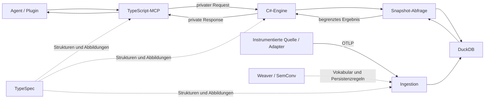

# Nami: vom Auftrag zur belastbaren Antwort

> **Vom Nutzer als Ziel- und Prüfbasis genehmigt · 27. Oktober 2026**
> Zweck: den Nutzen der besprochenen Architektur für Nami festhalten, Requests und Responses daran ausrichten und frühere Aussagen korrigieren.
> Status: dokumentierte Auswertung, keine neue Implementierungs- oder Testerfolgsbehauptung.

| Bezug | Grundlage |
| --- | --- |
| Produktentwurf | [Nami-PRD](nami.md) — gemeinsam genehmigte Zielbasis |
| Gespräch | [„Modelle vergleichen“](https://chatgpt.com/share/6ae0e54a-99f0-8327-9ed7-08942b1456b2) — 64 sichtbare Textnachrichten vollständig gelesen |
| Lokaler Vergleich | Nami auf Commit `e0dd040` **einschließlich des vorhandenen, nicht committeten Arbeitsstands** |
| Werkzeugstand | `global.json`: .NET `11.0.100-rc.3.26522.148`; aktiver TypeSpec-Compiler: `1.17.0` |
| Grenzen | Drei Plugin-Ausgaben im geteilten Chat sind redigiert. Die am Gesprächsende angekündigten drei Dateien wurden dort nicht mehr gezeigt. Verlinkte frühere Testberichte sind kein neuer Ausführungsnachweis. |

## 1. Das Ergebnis, für das wir Nami bauen

**Ein Agent soll eine konkrete Störung mit zugänglichen Laufzeitdaten untersuchen können, ohne die gesamte Telemetrie in sein Kontextfenster laden zu müssen.** Nami nimmt Daten entgegen, bewahrt ihre Bedeutung, grenzt Abfragen ein und liefert begrenzte, nachvollziehbare Ergebnisse. Der Agent interpretiert diese Evidenz und entscheidet über den nächsten Untersuchungsschritt.

Eine brauchbare Antwort sagt nicht nur, *was gefunden wurde*. Sie zeigt auch, **welche Quellen untersucht wurden, auf welchen Datenstand sie sich bezieht und was unbekannt bleibt**. „Keine Treffer“ darf weder fehlende Instrumentierung noch einen unvollständigen Eingang als gesunden Zustand ausgeben.

Das gewünschte Angebot ist ein öffentlich nutzbares Plugin, zunächst für OpenAI, mit einem im Kern anbieterunabhängigen Datenweg. Veröffentlichung, Hosting und Zugriff auf einen lokalen Rechner sind eigene Lieferfragen. Ein installiertes Plugin erzeugt keinen automatischen Zugriff auf Browserprozesse, Netzwerk-Sockets oder GPU-Zustände.

### Zwei konkrete Aufträge

| Auftrag | Was Nami beitragen soll | Grenze der Aussage |
| --- | --- | --- |
| „Seit dem Deployment ist unser Checkout langsam.“ | Passende Dienste und Zeitfenster eingrenzen; langsame Traces, korrelierte Fehler und Veränderungen aus vorhandenen Daten liefern; Folgeabfragen auf denselben Snapshot ermöglichen. | Ein zeitlicher Zusammenhang beweist noch keine Ursache. Fehlende Dienste oder Signale müssen erkennbar bleiben. |
| „Mein YouTube-Video hängt.“ | Zuerst offenlegen, ob für diesen Browser und Rechner überhaupt eine geeignete Datenquelle angebunden ist. Mit einer solchen Quelle anschließend deren tatsächlich zugängliche Befunde auswerten. | Ohne lokalen Adapter oder andere zulässige Quelle keine Behauptung über Media-Pipeline, Puffer oder GPU. Nami darf die fehlende Beobachtbarkeit nicht durch Vermutungen ersetzen. |

## 2. Die Begriffe, die bisher durcheinandergerieten

| Begriff | Bedeutung für Nami |
| --- | --- |
| Instrumentierung | Erzeugt Beobachtungen während einer Operation. Ein Attributname oder Schema allein beobachtet nichts. |
| SemConv-Katalog | Benennt und beschreibt Telemetrie: Schlüssel, Typen, Einheiten, Status und Beziehungen. Weaver bleibt die Quelle dieses Wissens. |
| TypeSpec-Modell | Definiert Nami-eigene Strukturen und ihre jeweiligen Darstellungen, nicht nur Netzwerk-DTOs. |
| Ingestion | Dekodiert eingehende OTLP-Daten, normalisiert sie und erhält relevante Bedeutung und Herkunft. |
| Speicherung und Abfrage | Speichert fachlich passende Repräsentationen und liefert gezielte, reproduzierbare Ausschnitte. |
| Telemetrie-Signal | Traces, Metriken und Logs haben unterschiedliche Regeln. Baggage ist propagierter Kontext; Resource und Scope sind Zuordnungskontext. |
| Definitionsart | Span-, Metrik-, Ereignis- oder Resource-Definition ist keine vollständige Liste aller transportierbaren Datenformen. Ein Span-Ereignis ist nicht dasselbe wie ein eigenständiger LogRecord. |
| Snapshot | Eingefrorene Datenansicht für reproduzierbare Abfragen. Keine Garantie, dass bereits alle Producer-Daten eingetroffen sind. |
| Beobachtungsdauer | Wie lange eine Quelle beobachtet wird. Unabhängig von Request-Timeout, Snapshot-Gültigkeit, Retention und Exportverzögerung. |

Die früheren Zahlen **91 Verzeichnisse, 88 deduplizierte Bereiche und 21 Stable-Bereiche** bezogen sich auf bestimmte historische Registry-Stände. Sie werden hier weder als aktueller Umfang noch als Sollzahl übernommen. Eine Abdeckungsmatrix muss aus den jeweils gepinnten Eingaben entstehen und Ausschlüsse begründen. Ein Stable-Filter für auswählbare Verträge ist außerdem etwas anderes als das Verwerfen fremder Development-Telemetrie beim Eingang.

## 3. Neun fachliche Prüfpunkte für Requests und Responses

Diese neun Punkte sind die verdichtete Bewertung dieses Dokuments. Sie ersetzen keine stillschweigend angenommene frühere Nummerierung; der historische Neun-Punkte-Abgleich steht in Abschnitt 8.

| ID | Request beziehungsweise Bedarf | Was eine nützliche Response leisten muss | Entscheidung für den Entwurf |
| --- | --- | --- | --- |
| N1 | Ein Agent untersucht ein konkretes Problem. | Relevante Evidenz mit Grenzen, statt unstrukturierter Vollausgabe oder unbelegter Diagnose. | Kernzweck. |
| N2 | Der Agent fragt nach Daten eines Projekts. | Nur Daten des durch Credentials bestimmten Projekts; kein Projektwechsel durch freie Tool-Argumente. | Isolation gehört in den Datenweg. |
| N3 | Ein Tool-Aufruf benötigt Eingabeprüfung. | Strukturierte Ablehnung auch für ungültige Rohdaten; nach Prüfung typisierte Zuordnung von Toolname, Input und Ergebnis. | TypeSpec und tatsächliche Verbraucher gemeinsam betrachten. |
| N4 | Eine Folgeabfrage soll denselben Befund vertiefen. | Derselbe Snapshot und dieselben relativen Zeitbezüge; keine unbemerkte Vermischung mit neu eingegangenen Daten. | Snapshot-Identität ausdrücklich mitführen. |
| N5 | Das Ergebnis muss ins Kontextfenster passen. | UTF-8-Bytebudget, Feldprojektion, begrenzte Seiten und sichtbare Kürzung; Cursor für Fortsetzungen. | Begrenzung ist Produktfunktion. |
| N6 | Daten fehlen oder treffen verspätet ein. | Quelle, Stille, Wasserlinie und Unvollständigkeit offenlegen; fehlende Daten nicht als Nullmessung oder Gesundheit deuten. | Aussagekraft vor scheinbarer Gewissheit. |
| N7 | Derselbe Wert durchläuft Collector, Storage und Tool. | Exakte Integer, Präsenz/null, Tags, Einheiten, Zeitursprung und nötige Herkunft bleiben erhalten. | Benannte Darstellungen mit expliziten Abbildungen. |
| N8 | Der Agent braucht eine beobachtbare Operation. | Bekannte Instrumentierungsabdeckung und Kontext; keine Behauptung über nicht beobachtete Aufrufe. | Instrumentierungsmechanismus nach konkreter Lücke wählen. |
| N9 | Transport, Prozess oder Export scheitert. | Endlicher Abschluss, klare Fehler, erkennbare Verluste und verwertbare Diagnoseartefakte. | Fehlerpfade sind Teil des Vertrags. |

## 4. Ein Datenweg mit unterschiedlichen Aufgaben



**Im heutigen Quellstand beobachtet:** Der MCP-Adapter ist TypeScript. Die C#-Engine hat den zentralen Instrumentierungspfad in [`EngineProtocol.cs`](../../src/nami/Hosting/EngineProtocol.cs); sie erzeugt dort Activity, Parent-Kontext und Dauer für Tool-Aufrufe. [`ToolDispatcher.cs`](../../src/nami/Tools/ToolDispatcher.cs) validiert Eingaben und bearbeitet Snapshot-Abfragen. Die eigene Collector-/Storage-Strecke existiert bereits.

**Noch keine daraus folgende Produktentscheidung:** Dass eine eigene Collector-Implementierung vorhanden ist, beweist nicht, dass jeder Collector-Baustein dauerhaft selbst entwickelt werden muss. Nami braucht Zugang zu Daten und für seinen aktuellen Datenweg eine Ingestion-Grenze. Welche Standard-Collector-Funktionen vorgeschaltet, übernommen oder selbst getragen werden, ist anhand des Nutzens und Betriebsaufwands zu entscheiden. Das ersetzt den heutigen Collector nicht automatisch.

Auch der komplette Dienst ist nicht „ein einziges NativeAOT-Binary“: Die C#-Engine kann nativ veröffentlicht werden; der TypeScript-/Bun-MCP bleibt eine eigene Laufzeitkomponente. Ein Vertriebspaket und ein einzelnes Executable sind unterschiedliche Zusagen.

## 5. Request-/Response-Beispiele

> Die folgenden Daten sind **illustrative Beispiele**, keine aufgezeichneteten Ergebnisse. Toolnamen und Feldnamen stammen aus den aktuellen TypeSpec-Definitionen. Gezeigt wird beim Ergebnis nur `structuredContent`, nicht der vollständige MCP-/JSON-RPC-Umschlag. Die Beispiele wurden in dieser Dokumentationsarbeit nicht gegen einen laufenden Server ausgeführt.

### A. Erst feststellen, was beobachtbar ist

Der Agent beginnt bei den Quellen, bevor er aus ausbleibenden Fehlern einen gesunden Zustand ableitet.

```json
{
  "name": "sources_status",
  "arguments": {
    "service": "checkout",
    "since": "-15m",
    "max_bytes": 8192
  }
}
```

```json
{
  "snapshot_id": "example-snapshot-1",
  "freshness": {
    "watermark": "2026-10-27T18:59:55Z",
    "complete": false,
    "examined": 2,
    "matched": 1,
    "returned": 1,
    "truncated": false
  },
  "services": [{
    "service": "checkout",
    "signals": [
      { "signal": "traces", "kind": "active", "last_seen": "2026-10-27T18:59:58Z" },
      { "signal": "logs", "kind": "silent", "silent_for": "PT15M" }
    ]
  }]
}
```

**Zulässige Interpretation:** Es gibt Trace-Aktivität; die gezeigte Log-Quelle ist still. Der angefragte Stand ist noch nicht vollständig bis zur Wasserlinie abgedeckt. `last_seen` beschreibt Empfangsaktivität; daraus folgt nicht, dass alle Ereignisse bis dahin vorliegen. Nicht dargestellte Quellen bleiben unbekannt. Die Anzahl untersuchter Statusdatensätze ist keine Anzahl aller gespeicherten Spans.

### B. Einen Befund begrenzt vertiefen

```json
{
  "name": "traces_slowest",
  "arguments": {
    "service": "checkout",
    "since": "-15m",
    "snapshot_id": "example-snapshot-1",
    "limit": 3,
    "max_bytes": 8192,
    "fields": ["trace_id", "operation", "duration_ms"]
  }
}
```

```json
{
  "snapshot_id": "example-snapshot-1",
  "freshness": {
    "watermark": "2026-10-27T18:59:55Z",
    "complete": false,
    "examined": 120,
    "matched": 1,
    "returned": 1,
    "truncated": false
  },
  "traces": [{
    "trace_id": "0123456789abcdef0123456789abcdef",
    "operation": "POST /checkout",
    "duration_ms": 842
  }]
}
```

Der Agent kann anschließend mit `traces_get` dieselbe Trace-ID im selben Snapshot untersuchen. Nicht angeforderte Felder bleiben abwesend. Eine langsame Trace ist ein Ansatzpunkt; die Response behauptet noch keine bewiesene Ursache.

Ein `next_cursor` bedeutet eine Fortsetzung gemäß Tool-Vertrag. Cursor, Tool, Snapshot und übrige Abfrageargumente müssen zusammenpassen. Ob Ranking-Limit, Seitenlimit oder Bytebudget Treffer zurückhalten, muss in der Ergebnissemantik erkennbar sein.

### C. Ungültige Eingaben ausdrücklich beantworten

Ein `max_bytes` von `12` liegt unter der derzeit in TypeSpec definierten Untergrenze `1024`. Eine schematische Fehlerantwort lautet:

```json
{
  "code": "invalid_argument",
  "message": "The response budget is below the allowed minimum.",
  "retryable": false,
  "field": "max_bytes"
}
```

Der englische Text ist beispielhaft; maßgeblich sind Fehlerklassifikation und Felder. Für „Signal nicht unterstützt“, „Quelle still“, „keine Treffer“, „nicht autorisiert“ und „Serverfehler“ darf es keine gemeinsame scheinbar erfolgreiche Leerantwort geben. Der derzeitige Dispatcher weist angefragte `profiles`/`baggage` als `data_unavailable` zurück; das ist keine generelle Aussage über deren Bedeutung in OpenTelemetry.

### D. Die private Engine-Verbindung trägt den Aufruf, nicht eine zweite Fachwelt

[`engine.tsp`](../../contracts/models/engine.tsp) beschreibt derzeit `call`, `health` und `cancel`, dazu Request-ID und Vertragsrevision. `call` führt Toolname, rohe Eingabe, Credential und Trace-Kontext mit. `EngineResponse` führt `id`, `revision`, `result` und `is_error`.

- Rohe Eingabe darf zunächst `unknown` sein, damit auch ungültige Daten eine kontrollierte Ablehnung erreichen.
- Die Zuordnung nach erfolgreicher Validierung soll aus den Tool-Verträgen entstehen. `unknown` ersetzt dort keinen fachlichen Typ.
- Request-ID korreliert einen Aufruf; Snapshot-ID identifiziert Daten. Sie sind nicht austauschbar.
- Abbruch braucht eine definierte Transportsemantik. Das vorhandene `cancel` allein beweist nicht, dass jeder wartende Client rechtzeitig abgeschlossen wird.
- Für länger lebende Beobachtungen wären eigene explizite Kennungen nötig. Für eine Snapshot-Abfrage muss keine zusätzliche Beobachtungssitzung erfunden werden.

## 6. TypeSpec umfasst die Modelle hinter der Antwort

[`emit-config.tsp`](../../contracts/emit-config.tsp) ordnet heute bereits mehrere Ausgaben zu. Diese Zuständigkeit ist breiter als „C# und TypeScript haben dieselben DTOs“.

| Darstellung | Aufgabe | Was beim Übergang erhalten bleiben muss |
| --- | --- | --- |
| Ingestion | Typisierte eingegangene Werte, Ressourcenbezug, Normalisierung und Zeitursprung. | Vollständige Integer, Originalbedeutung und ausdrücklich modellierte Herkunft. |
| Storage-JSON | Rekursive Attributwerte und Metrik-Payloads in JSON-Spalten. | Gespeicherte Tags, Bytes, nichtendliche Zahlen, erforderliches `null` und fehlende Werte unterscheiden. |
| Storage-Rows | Physische Tabellenzeilen für den DuckDB-Generator. | SQL-Typen, Nullbarkeit, Schlüssel, Reihenfolge, Defaults und vom Insert ausgenommene Spalten. |
| Tools | Auswählbare Felder, Input, Erfolg, Fehler und Defaults. | Bytebudget, Projektion, präzise Wertecodierung, Diskriminatoren und Präsenz. |
| Engine | Privater Transport und Zuordnung zu ausstehenden Aufrufen. | Identität, Revision, erlaubte Varianten und kontrollierte Grenzen. |

Gemeinsame Fachwerte rechtfertigen gemeinsame Definitionen. Unterschiedliche Tags, Feldmengen oder Identitätsrollen brauchen benannte Darstellungen und explizite Abbildungen. Ein API-Tag `kind` muss deshalb nicht den Storage-Tag `type` ersetzen. Dictionary-Schlüssel bleiben Nutzdaten, auch wenn sie so heißen wie ein Diskriminator.

TypeSpec beschreibt die Strukturen; fachliche Algorithmen bleiben ausdrücklich benannt. Beispielsweise sind Hash-Kanonisierung, Messwertgleichheit, Reihenfolge und Auswahl identitätsrelevanter Felder nicht allein durch einen passenden Property-Typ festgelegt. Eine Änderung dieser Regeln kann Identitäten ändern.

Für unionsartige Daten kann TypeSpec eine flache Diskriminierung oder einen Umschlag definieren. Die Emitter und Serializer müssen diese Form erhalten; eine C#-Union erzeugt nicht automatisch den gewünschten JSON-Vertrag. [TypeSpec: diskriminierte Typen](https://typespec.io/docs/standard-library/discriminated-types/)

`@encodedName` und Wertecodierung haben verschiedene Aufgaben: etwa `maxBytes` im TypeScript-Code, `MaxBytes` im C#-Code und `max_bytes` in JSON. Volle 64-Bit-Integer dürfen beim Weg durch JavaScript nicht still auf ungenaue `number`-Werte reduziert werden. Auch optional + nullable benötigt drei unterscheidbare Zustände.

**Nicht behauptet:** dass jede dieser Modellgruppen heute vollständig migriert ist oder jede Abbildung bereits ausschließlich generiert wird. Ausgabekonfiguration und existierende Typen belegen noch keine lückenlose Verbraucherumstellung.

## 7. Instrumentierung: Fähigkeit verlangen, Mechanismus begründen

### Für Namis eigene Tool-Aufrufe

Der heutige zentrale Pfad in `EngineProtocol.cs` kann bekannte Tool-Aufrufe unmittelbar beobachten. Solange er alle zugesagten Aufrufe korrekt erfasst, rechtfertigt das Fehlen eines Telemetrie-Generators keinen zusätzlichen Generator. Zu prüfen bleiben Context-Propagation, Parallelität, Exception-/Cancellation-Pfade, Dauer und genau ein Abschluss.

### Für zusätzliche Anwendungsmethoden

Compile-Time-Interception ist ein möglicher Erweiterungsweg. Der Generator löst Marker und Modellvertrag beim Build auf; der Compiler ersetzt unterstützte Aufrufstellen. Der fertige Wrapper läuft später im nativen Programm. Das funktioniert grundsätzlich ohne CLR-Profiler und ohne Laufzeit-Codegenerierung, erfasst aber nicht automatisch innere Aufrufe bereits kompilierter Fremdbibliotheken. [Roslyn: Interceptors](https://github.com/dotnet/roslyn/blob/main/docs/features/interceptors.md), [Microsoft: AOT-kompatible Konfigurationsgenerierung](https://learn.microsoft.com/en-us/dotnet/core/extensions/configuration-generator)

Ein Skill kann die Generierung und den Build orchestrieren. Er kann einem bereits veröffentlichten NativeAOT-Binary keine neuen kompilierten Aufrufstellen hinzufügen. XML ist dabei gegebenenfalls Konfiguration; Code muss ihre Regeln umsetzen. Rust oder TypeScript benötigen ihre jeweils eigenen Instrumentierungspunkte, keinen C#-Interceptor.

Eine eigene solche Erweiterung wird sinnvoll, sobald eine benötigte Operation mit bestehenden Instrumentierungen, zentralen Aufrufpfaden oder Adaptern nicht ausreichend beobachtbar ist. „Automatisch alle Methoden aller Anwendungen“ wird nicht zugesagt.

### Sampling, Verluste und Vollständigkeit

Eine Zusage „jede geeignete Operation wird aufgezeichnet“ muss den Umfang, die Sampling-Entscheidung, Startreihenfolge und Überlastgrenzen definieren. Selbst explizites AlwaysOn verhindert keine Queue-Verluste, Exportfehler oder Prozessabbrüche.

Im gelesenen [`NamiSelfTelemetry.cs`](../../src/nami/Telemetry/NamiSelfTelemetry.cs) ist kein expliziter Sampler gesetzt. Das bestätigt die fehlende ausdrückliche Konfiguration, **nicht allein eine im aktuellen Lauf nachgewiesene Unterdrückung**. Die Wirkung muss mit der aktiven OTel-Version, Konfiguration und insbesondere einem Parent mit Trace-Flag `00` getestet werden.

OTLP-Annahme bedeutet außerdem nicht automatisch dauerhafte Speicherung oder duplikatfreie Ende-zu-Ende-Zustellung. Partial Success, Wiederholung und verlorene Antworten benötigen passende Behandlung. [OTLP-Spezifikation](https://opentelemetry.io/docs/specs/otlp/)

## 8. Abgleich mit meinen früheren Antworten

### Die zwei Architekturkorrekturen im geteilten Chat

| Frühere Aussage | Korrektur | Konsequenz hier |
| --- | --- | --- |
| „Instrumentierung gehört zu tomo; Nami ist nur der Empfänger.“ | Falsche Einschränkung des vom Nutzer beschriebenen Bewertungsumfangs. Nami wird über den ganzen benötigten Datenweg beurteilt; ein Beispiel-Producer bestimmt nicht die Produktgrenze. | Instrumentierung, Ingestion, Storage und Agent-Antwort stehen gemeinsam im Dokument. |
| „Ohne Marker, generierte Interceptors und clientgebundene XML-Lebenszeit fehlt der zentrale Architekturteil.“ | Ein fehlender Mechanismus beweist keine fehlende Fähigkeit. Ein zentraler Tool-Aufrufpfad und unabhängige Ingestion können den konkreten Bedarf bereits erfüllen. | Kein pauschales Nachrüsten. Zusätzliche Instrumentierung nur für eine benannte Abdeckungslücke; Snapshot und Beobachtung getrennt halten. |

### Die neun zuvor beschriebenen historischen Stationen

Der Nutzer hat die hier gemeinten **neun Stationen des Projektverlaufs** ausdrücklich zitiert und damit die Zuordnung bestätigt. Sie sind keine neun bereits beschlossenen Produktanforderungen. Ihre heutigen Eigentümer, der Umgang mit allen angefragten Altdateien und die noch nötigen Sicherungsschritte stehen im [Aufräumregister](../integration/workspace-handoff.md). Die ursprüngliche Migration wird nicht erneut begonnen.

| Nr. | Frühere Station | Verhältnis zu diesem Entwurf |
| --- | --- | --- |
| 1 | Materialisierte Fixture-Projekte im Downloads-Prototyp. | Nützlich zum Prüfen echter SDK-Grenzen; kein Laufzeitbaustein des Plugins. |
| 2 | Erster Materialisierungsstand, Commit `499ecdf`. | Historischer Machbarkeitsstand, keine heutige Produktabnahme. |
| 3 | Compiler, PE-Inspektion, Feed und Evidenz, Commit `cbe5b4b`. | Werkzeuge für gezielte Nachweise auf unterschiedlichen Ebenen. |
| 4 | Reflection-freie und Werkzeug-Ergänzungen, Commit `34d902a`. | Hilfreiche Umsetzungseigenschaften, kein Ersatz für fachliche Assertions. |
| 5 | Umbenennung Qyl → Nami und Klärung des TypeScript-MCP. | Ein Rename überträgt keine Produktannahmen. MCP bleibt hier ausdrücklich TypeScript. |
| 6 | Übernahme geeigneter Fixture-Infrastruktur und Union-Prüfungen in Nami. | Nachweise sollen tatsächliche generierte Typen und Verbraucher schützen, nicht eine isolierte Demonstration. |
| 7 | Nami-Snapshot `e0dd040` im privaten Repository gesichert. | Herkunft des Baselines, kein Beweis für den inzwischen veränderten Arbeitsbaum. |
| 8 | Eigenständiger Architecture-Review-Arbeitsbereich. | Produktziel zuerst; alte Dokumente und Code bleiben überprüfbare Eingaben. |
| 9 | Weitere Ansätze im Playground. | Bausteine gezielt bewerten; keine ungeprüfte Übernahme einer zweiten Architektur. |

Das frühere Fixture-Konzept bleibt damit sinnvoll: Definition im Speicher, echte SDK-Ausführung bei Bedarf in einer temporären Umgebung, Evidenz vor Cleanup sichern. Es beantwortet **wie wir prüfen**, nicht **was Nami seinen Nutzern liefern soll**.

### Die zwei zusätzlich offenen Zeit-/Timeout-Fundstellen

Diese gehören zur späteren Patch-/Playground-Auswertung, nicht zu den zwei Architekturkorrekturen oben:

1. In [`HostTransportTests.cs`](../../tests/Nami.EndToEndTests/HostTransportTests.cs) begrenzt die äußere 20-Sekunden-Schleife nicht den einzelnen wartenden `CallAsync`, solange dieser nur den größeren Test-Token erhält. Ziel: eine Deadline für den gesamten Polling-Vorgang einschließlich Requests und Delays.
2. [`McpHarness.WaitForHealthAsync`](../../tests/Nami.Tests/Infrastructure/McpHarness.cs) wartet nach gemeldetem Child-Exit auf den stderr-Drain des weiterlebenden Ownership-Hosts. Das Warten kann den Cleanup blockieren, der den Stream erst schließen würde, und beobachtet den Health-Timeout nicht. Ziel: Fehler melden und Diagnose begrenzt sichern, ohne diesen zyklischen Wartezustand.

Beide sind erneut im Quelltext erkennbare Risiken, **keine hier reproduzierten Laufzeitfehler**. Der Time-Fixes-Patch wurde nicht angewandt. Dieses Dokument behebt keinen der beiden Pfade.

### Weitere Aussagen, die wir nicht fortschreiben

- Die alte Stable-only-Auswahl ist eine mögliche versionierte Policy, keine heutige universelle Sperre für freigegebene Preview-Funktionen oder eingehende Telemetrie.
- Alte RC2- und Veröffentlichungsdatumsangaben bestimmen nicht den lokalen RC3-Werkzeugstand.
- Vier Definitionsarten beweisen keine vollständige Unterstützung aller Signale.
- „Keine Sampling-Lücke“, „keine Transportverluste“ und „vollständiger Snapshot“ sind unterschiedliche Behauptungen.
- „154 Tests bestanden“ aus dem geteilten Chat und spätere historische Testergebnisse werden nicht als aktuelle Verifikation wiederholt.
- Die Behauptung, derselbe JSON-Roundtrip müsse immer byteidentisch sein, ist zu weit: semantische Gleichheit ist der normale Codec-Vertrag. Byteidentität braucht eine eigene kanonische Ausgabe- oder Replay-Zusage.

## 9. Welche Nachweise wirklich zum Produkt gehören

| Ebene | Geeignete Nachweise | Was sie allein nicht beweist |
| --- | --- | --- |
| `Nami.Tests` — gemeinsame Infrastruktur | Compiler-, Metadaten-, Fixture- und Prozesshilfen; Evidenz vor Cleanup. | Kein eigenständiger vierter fachlicher Testtyp. |
| `Nami.UnitTests` | Exakte Zahlen, Presence/null, Mapping, Identitätsregeln, Zeitgrenzen, Budgetentscheidungen und reine Abfragelogik. | Kein echter SDK-Build, Transport oder natives Deployment. |
| `Nami.IntegrationTests` | Echte generierte Verbraucher, Compilerfehler bei fehlenden Varianten, OTLP→Storage, DB-Bindings und Prozess-/Fixture-Lebenszeit. | Nicht automatisch die reale Plugin-/Engine-Kette. |
| `Nami.EndToEndTests` | Tatsächlicher TypeScript-MCP plus veröffentlichte Engine: Anfrage→Validierung→Abfrage→Response; Projektisolation, Abbruch und geordnetes Ende. | Nicht automatisch eine fremde Anwendung oder Browserquelle. Dafür braucht es eine passende Probe beziehungsweise einen Adapter. |

Priorität für die weitere Abnahme:

- **P1 – Antwortvertrag:** falsche Eingabe, stiller Eingang, fehlendes Signal, Snapshot-Wiederholung, Bytebudget und Feldauswahl unterscheiden sich sichtbar.
- **P2 – Bedeutungstreue:** sämtliche zugesagten Metrikvarianten über den echten Eingang prüfen; Integer, Tags, Herkunft und Identitäten über die tatsächlich benutzten Abbildungen erhalten.
- **P3 – Abschluss:** Parallelität, Cancellation, Kindprozessfehler und geordneter Shutdown mit ausstehenden Daten. Die zwei Timeout-Risiken gehören hierhin.
- **P4 – Beobachtbarkeit:** Instrumentierung nur für zugesagte Ziele nachweisen; bei „vollständiger Aufzeichnung“ auch nicht gesampelte Parents, Startreihenfolge, Überlast und Verlustmeldung prüfen.
- **P5 – zusätzliche Quellen:** Browser-/Systemadapter erst für einen definierten Nutzerauftrag und mit überprüfbarem Zugriffsumfang ergänzen.

Bei Instrumentierungsproben müssen Ausführung, Erzeugung, Exportannahme, Speicherung und Abfragbarkeit unabhängig unterscheidbar sein. Ein selbst erzeugtes OTLP-Payload prüft den Eingang; es beweist nicht, dass eine reale Anwendung korrekt instrumentiert wurde. Eine Quelle darf wiederum korrekt instrumentiert sein, obwohl ihr Export noch nicht beim Collector angekommen ist.

## 10. Offene Entscheidungen, ohne neue Nebenarchitektur

- [ ] Ersten Lieferfall festlegen: instrumentierte Entwickleranwendung oder zusätzlicher Browser-/Systemadapter. Empfehlung: zuerst den vorhandenen Datenweg einer Entwickleranwendung vollständig abnehmen.
- [ ] Aufzeichnungszusage konkretisieren: welche Quellen und Operationen, welche Sampling-Policy, welche sichtbaren Verlustgrenzen?
- [ ] Wasserlinie und `complete` fachlich abschließend benennen; die aktuelle TypeSpec-Beschreibung darf keinen allwissenden Abschluss sämtlicher Producer suggerieren.
- [ ] Eigene Collector-Verantwortung gegenüber vorgeschalteten Standard-Komponenten festlegen, ohne vorhandene Implementierung allein wegen ihrer Existenz zum Soll zu erklären.
- [ ] Erst danach eventuelle neue Marker-/Interceptor- oder Beobachtungs-APIs beauftragen.

**Ergebnis dieses Dokuments:** Ein gemeinsamer Request-/Response-Maßstab und ein nachvollziehbarer Abgleich liegen vor. Es wurden keine Produktimplementierung, kein Patch und keine historischen Anweisungen automatisch übernommen. Neue Codeänderungen und ihre Nachweise bleiben eigene, konkret zu erledigende Arbeit.
