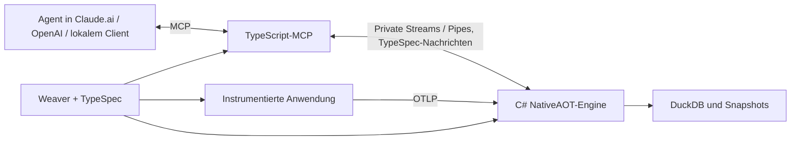

# nami — PRD

Oct 24, 2026 · @Alexander Nachtmann

## 1. Zweck und Nutzer

nami ist ein Stack für **agentengesteuertes Debugging**: Instrumentierung erfasst die Ausführung einer Anwendung, eine C#/.NET-11-NativeAOT-Engine nimmt Telemetrie an und speichert sie in DuckDB, und ein TypeScript-MCP-Server liefert Agenten begrenzte, typisierte Antworten. Die Produktoberfläche besteht aus Tools. Es gibt kein Dashboard und keine für Menschen bestimmte Analyseoberfläche.

Ein Entwickler beauftragt einen Agenten mit der Untersuchung seiner Anwendung. Der Agent nutzt nami über einen **Claude.ai-Connector und/oder ein OpenAI-Plugin mit gebündelter MCP-Anbindung**. Lokale agentische Clients wie Claude Code können denselben MCP-Vertrag nutzen. Menschen konfigurieren und autorisieren den Zugang; die Debugging-Aufrufe und ihre Auswertung erfolgen durch Agenten.

**Beispiel:** tomo ist hier ein Rust-Entwickler, der seine Anwendung mit dem nami-Stack durch einen Agenten debuggen lässt. tomo bezeichnet weder eine vorgeschriebene Runtime noch die einzige Zielanwendung. Die Produktanforderungen gelten für alle unterstützten Anwendungen und Agentenhosts.

nami übernimmt die Collector-/Analysegrundlage und das TypeScript-MCP-Muster aus qyl `ecdfb564`. TypeSpec bleibt die gemeinsame Quelle für Nachrichten, Typen und JSON-Schemas; Weaver bleibt die Quelle für semantische Definitionen und Persistenzregeln. Die Herkunft schränkt weder Zielsprachen noch Connectoren ein.

**Zielstand und Umsetzung:** Diese Fassung ersetzt die frühere Festlegung auf einen C#-MCP-Server in genau einem Prozess. Der vorhandene C#-Host ist ein bisheriger Implementierungsstand, kein Beleg für die Umsetzung des neuen Ziels. Die Migration, die Instrumentierung und die zusätzlichen Nachweise werden in [der Checkliste](../checklist.md) separat geführt. Bestehende grüne Tests belegen nur die von ihnen ausgeführten Pfade.

Erfolg ist an überprüfbarer Ausführung erkennbar: Die Registry und Generierung sind reproduzierbar; eine deklarierte Operation wird genau einmal mit korrektem Kontext beobachtet; ihre angenommenen Daten werden unter kontrollierter Last innerhalb einer Sekunde abfragbar; jede Antwort bleibt unter `max_bytes`; ein leeres unvollständiges Fenster wird nie als Fehlerfreiheit ausgegeben. Abschnitt I definiert die Instrumentierungsnachweise, Abschnitt T die sechs Analyse-Tools.

## 2. Problem und Produktgrenze

Agenten benötigen Belege darüber, was eine Anwendung tatsächlich ausgeführt hat, wie lange es dauerte, welche Fehler auftraten und welche Daten fehlen. Ein Roh-Dump und eine vermeintlich leere Fehlerliste ohne Vollständigkeitsangabe reichen dafür nicht.

- **Ein semantischer Vertrag über Sprachgrenzen.** C# und TypeScript erhalten ihre Typen aus derselben TypeSpec-Quelle. Abweichende Releases werden durch Vertragsrevisionen erkannt. Zwei Sprachen sind kein Vertragsfehler; unkoordinierte oder inkompatible Artefakte sind ein Betriebsproblem.
- **Explizite Instrumentierungsabdeckung.** Marker, Modellmanifest und generierte Wrapper bestimmen, welche Aufrufstellen erfasst werden. Nicht erfasste Abhängigkeiten und Aufrufformen werden ausdrücklich ausgewiesen. Ein laufender Prozess allein beweist keine vollständige Beobachtung.
- **Begrenzte Antworten für Agenten.** Sechs lesende Analyse-Tools liefern Gruppen, Ränge, IDs, Freshness und Fortsetzungen. Kein Dashboard, kein menschlicher Analyseworkflow, keine synthetische Produktionstelemetrie.
- **Beobachtungszustand mit eigener Lebenszeit.** Eine langlebige Beobachtung ist Anwendungszustand mit expliziter Kennung. Sie hängt weder an einer MCP-Verbindung noch an einer pauschalen 15-Minuten-Frist.

## 3. Was von qyl bleibt und sich ändert

| Bestandteil | Entscheidung für nami | Grund |
| --- | --- | --- |
| C#-Collector, OTLP/HTTP und OTLP/gRPC, DuckDB, Analyse-Engine und Sanitizer | Bleiben Grundlage der Engine | Vorhandene Aufnahme, Speicherung und Abfragen erhalten |
| TypeScript-MCP auf Bun und offiziellem MCP-TS-SDK v2 | Wird als Muster für die nami-MCP-Schicht übernommen | Tool-Entwicklung und agententaugliche SDK-Dokumentation bleiben im TypeScript-Ökosystem |
| TypeSpec mit C#-, TS- und Lint-Emittern sowie JSON Schema | Bleibt; TS-Typgenerierung wird für nami wieder ergänzt | Ein Vertrag für beide Implementierungen, keine handgepflegten doppelten Modelle |
| Öffentliche REST-Analyse-API | Entfällt | Agenten nutzen MCP; die lokale Engine-Anbindung braucht keine zusätzliche Produkt-API |
| Interne HTTP-Anbindung aus qyl | Wird lokal durch private, langlebige Streams/Pipes ersetzt | Gemeinsam gestartete Prozesse brauchen keinen internen REST-Endpunkt; keine unbelegte Performancebehauptung |
| Projektbindung, geprüfte Credentials und Vertragsrevision | Bleiben an allen Grenzen | Transportwechsel darf Mandantentrennung und Validierung nicht abschwächen |
| Weaver-Registry, C#/Rust-Generierung und Persistenzregeln | Bleiben im Repository | Semantische Definitionen sind unabhängig von der Sprache des MCP-Servers |
| Compile-Time-Interception und konfigurierte Beobachtung | Gehören zum Produktumfang | Unterstützte Aufrufstellen werden beim Build gebunden; Laufzeitcode verwaltet Dauer, Export und Abschluss |
| Skills und Connector-/Plugin-Bundles | Gehören zur Agentenintegration | Claude.ai und OpenAI sollen denselben Toolvertrag verwenden können |
| Schreibende Analyse-Tools und Telemetrie-Löschung durch Tools | Entfallen | Die sechs Analyse-Tools sind lesend; Retention bleibt der einzige Telemetrie-Löschpfad |
| Menschliches Dashboard und UI-Analyse | Entfallen | Ausschließlich agentische Debugging-Oberfläche |
| MSTest/MTP, reale OTLP-/DuckDB- und NativeAOT-Nachweise | Bleiben und werden erweitert | Der gesamte Stack muss am veröffentlichten Artefakt nachgewiesen werden |

## 4. Architektur und Instrumentierung

### 4.1 Komponenten und Datenfluss

Ein gemeinsamer Release enthält eine **TypeScript-MCP-Schicht** und eine **C#-NativeAOT-Engine**. Ein einzelnes natives Binary für den ganzen Stack ist kein Zielkriterium. Die Engine braucht keine separat installierte .NET-Laufzeit; TypeScript/Bun-Abhängigkeiten und native Bibliotheken gehören in die deklarierte Paketierung.



1. **Definition → Build.** Weaver löst den gepinnten semantischen Katalog auf. TypeSpec definiert Nachrichten und Toolformen. Die Generierung erzeugt C#-/TypeScript-Typen, JSON-Schemas und die für unterstützte Zielsprachen benötigten semantischen Artefakte reproduzierbar.
2. **Build → Aufrufstelle.** Bei C#/.NET binden Compiler und Generator deklarierte, unterstützte Aufrufstellen an generierte Interceptor-Wrapper. Ein Marker kann per Enum eine Modellkennung wählen; der Generator löst sie beim Build eindeutig auf. Bereits kompilierte Abhängigkeiten werden dadurch nicht pauschal intern instrumentiert.
3. **Aufruf → Beobachtung.** Zur Laufzeit führt die bereits kompilierte Aufrufstelle den generierten Wrapper aus. Dieser verwendet den beim Build aufgelösten Telemetrievertrag, beobachtet die ursprüngliche Operation und übergibt deren Telemetrie an die konfigurierte Pipeline. Die Laufzeitlogik verwaltet die Beobachtungsdauer.
4. **Export → Speicherung.** Reale OTLP-Daten gelangen über HTTP (protobuf/JSON) oder gRPC in die projektgebundene Engine. Sie normalisiert semantische Attribute, wendet Persistenz- und Sanitizer-Regeln an und führt Wasserlinien und Empfangszeiten.
5. **Abfrage → Antwort.** Die C#-Analyse arbeitet über einem konsistenten Snapshot. TypeScript validiert die privaten Nachrichten, registriert die MCP-Tools und formt die begrenzte Agentenantwort mit Headline, strukturiertem Ergebnis und Freshness.
6. **Durchgängige Zuordnung.** Trace-/Span-IDs, Projektbindung, Vertragsrevision und explizite Beobachtungs-/Snapshot-Kennungen halten Ausführung, Export, Speicherung und Abfrage zusammen. namis Selbsttelemetrie benutzt dieselbe semantische Grundlage, ohne eine unendliche Export-/Ingest-Schleife zu erzeugen.

### 4.2 Lokale Streams, gehostetes MCP und Sicherheit

Lokal startet der TypeScript-Launcher die Engine und besitzt die privaten Ein-/Ausgabekanäle. Nachrichten sind gerahmtes UTF-8-JSON nach TypeSpec; JSON Lines eignet sich für vollständige kompakte Nachrichten, nicht für unmarkiert ineinander verschachtelte Teilantworten. Request-IDs ordnen konkurrierende Antworten zu. Abbruch, Fehler, maximale Nachrichtengröße, Backpressure, Prozessende und Vertragsrevision sind Teil der internen Grenze. Externes MCP-stdout und der private Engine-Kanal bleiben getrennt; Diagnoseausgabe geht auf stderr.

Die Engine kann mit generiertem `JsonTypeInfo<T>` direkt in `Stream`/`PipeWriter` serialisieren. .NET-11-Speicher-Streams vermeiden unnötige Zwischenkopien innerhalb des Prozesses; sie teilen keinen verwalteten Heap mit TypeScript. Gemeinsamer Speicher oder FFI sind keine Voraussetzung. Weniger Kopien und geringere Latenz werden gemessen, nicht aus dem Transportnamen abgeleitet. Internes HTTP ist kein Pflichttransport.

Gehostete Claude.ai-Connectoren und OpenAI-MCP-Integrationen erreichen die TypeScript-Schicht über das vom Host unterstützte Remote-MCP-Verfahren, insbesondere Streamable HTTP. Ein Bundle umfasst die MCP-Anbindung und die zum Gebrauch erforderlichen Skills/Metadaten; Paketierung und Authentifizierung richten sich nach dem konkreten Host. Eine allgemeine C#- oder Single-Binary-Vorgabe wird daraus nicht abgeleitet. Lokales stdio ist eine zusätzliche Bereitstellung, nicht der einzige Produktzugang.

Jede Anfrage bleibt im authentifizierten Projekt. Die MCP-Schicht leitet die interne Projektbindung aus geprüften Credentials ab; Toolargumente, unbestätigte Header und freie `_meta`-Felder wählen kein Projekt. Auch die Engine prüft ihre private Vertrauensgrenze. Telemetrie und fremde Dokumente sind untrusted Daten, niemals Instruktionen.

### 4.3 Beobachtungslebenszeit und Sprachgrenzen

MCP `2026-07-28` ist stateless auf Protokollebene. Eine dauerhaft offene Pipe oder ein Prozess darf für Effizienz bestehen bleiben. Projekt, Fähigkeiten und Beobachtungszuordnung werden trotzdem ausdrücklich übertragen; über mehrere Requests benötigter Zustand wird durch eine explizite, projektgebundene Kennung referenziert. Verbindungsidentität ersetzt keine Beobachtungsidentität.

XML beschreibt die konfigurierte Lebenszeitregel; ausführbarer Laufzeitcode setzt sie durch. Absolute Frist, Inaktivitätsfrist, Erneuerung, explizites Beenden, Request-Timeout, Datenaufbewahrung und Exportverzögerung sind getrennte Regeln. Es gibt keine versteckte 15-Minuten-Grenze. Die sechs Analyse-Tools bleiben lesend; Build-/Start-/Beobachtungskonfiguration wird nicht als zusätzliches schreibendes Analyse-Tool eingeschmuggelt.

Skills können Builds orchestrieren und vorhandene Tools ausführen. Ein bereits veröffentlichtes NativeAOT-Artefakt erhält durch einen Skill keine neuen kompilierten Interceptors. Neue Konfiguration im vorbereiteten Umfang ist möglich; neue generierte Implementierung benötigt einen neuen Build. C#-Interceptors benötigen keinen CLR-Profiler und keinen JIT; benötigte .NET-Laufzeitbestandteile bleiben im nativen Artefakt enthalten.

C#-Interception erfasst C#-Aufrufstellen der jeweiligen Compilation. Andere Zielsprachen verwenden passende Instrumentierung und denselben semantischen Vertrag; Rust kann beispielsweise `tracing`, `#[instrument]` und OTLP verwenden. Ein externer C#-Collector instrumentiert keine Rust-Funktionen durch seine bloße Existenz.

### 4.4 Definitionsarten und Signalabdeckung

`ResourceDefinition` beschreibt signalübergreifenden Kontext. `SpanDefinition` beschreibt Spans, `MetricDefinition` Instrumente, Einheiten und Aggregationsanforderungen. `EventDefinition` legt ausdrücklich fest, ob das Ziel ein Log-Ereignis oder ein Span-Ereignis ist. Allgemeine Logs benötigen ebenfalls eine deklarierte Darstellung, wenn sie zum unterstützten Umfang gehören. Die vier Namen allein beweisen keine vollständige Signalabdeckung.

Die Modellmanifest-Prüfung umfasst sämtliche deklarierten Definitionen, referenzierten Attribute und eingeschränkten Enum-Werte. Bei einer Stable-only-Auswahl muss jedes dieser Elemente die Stable-Regel erfüllen; ein stabiles Modell legitimiert kein instabiles Mitglied. Offene String-Werte bleiben offen. Die Registry darf weiterhin ausdrücklich gewählte Development-Definitionen für MCP-/GenAI-Selbsttelemetrie führen.

Die verbindlichen Einzelbeweise stehen in Abschnitt I. Unterstützter Umfang, Ausschlüsse, Zeitmessung, Exportverluste und Abfragbarkeit werden am veröffentlichten Stack belegt, nicht aus erfolgreich generiertem Code geschlossen.

## 5. Semconv-Registry `nami`

Die Registry liegt im nami-Repo und folgt dem Aufbau von `semantic-conventions-genai`: ein `manifest.yaml`, Modelldateien pro Namespace, Jinja-Templates, Policies, ein Skript-Verzeichnis. Sie ist **development** und importiert Stable **und** Development aus Core und GenAI.

```yaml
name: nami
description: nami conventions for agent-facing observability; every key is prefixed nami.
schema_url: https://ancplua.github.io/nami/schemas/0.1.0   # Format zählt, Abrufbarkeit nicht
stability: development
dependencies:
  - schema_url: https://opentelemetry.io/schemas/1.44.0
    registry_path: https://github.com/open-telemetry/semantic-conventions.git@v1.44.0[model]
  - schema_url: https://opentelemetry.io/schemas/gen-ai-dev/1.42.0-dev
    registry_path: https://github.com/open-telemetry/semantic-conventions-genai.git@9ffc7e00c639be7712e544e3e54331e885dccf84[model]
```

**Pins (24.10.2026).** Core `v1.44.0` (`e10a9308`); `main` ist `3e258047` und nur Dokumentation voraus, die Registry unter `model/` ist identisch. GenAI `9ffc7e00`, ohne Tag und ohne eigene Stable-Definitionen; sein Manifest importiert Core `v1.44.0`. Weaver `0.28.0`. Beide Dependencies nennen dieselbe Core-`schema_url`; Weaver löst Versionskonflikte über diese URL auf. Ob 0.28.0 die verschachtelte Abhängigkeit (nami → genai → core) ohne Doppelung auflöst, prüft `weaver registry check --future` als erster Gate-Schritt.

**Inventar, das nami erbt.** Stable aus Core: 21 Bereiche, 121 Attribut-Keys, 8 Span-Formen, 51 Instrumente, 1 Event (`exception`), 5 Resource-Definitionen; `exception.escaped` ist deprecated und nicht enthalten. Development aus Core und GenAI: `gen_ai.*`, `mcp.*`, `session.*`, `cicd.*`, `vcs.*`, `process.*`, `rpc.*` und die übrigen 67 Bereiche. Stabilität ist pro Definition ein Feld im aufgelösten Schema, nie eine Annahme über das Paket.

**`nami.*`-Konventionen.** Die qyl-eigenen Keys werden umbenannt und in der Registry definiert, nicht in einem Paket: `nami.project.id` (Projekt-Zuordnung einer Resource), `nami.attribute.namespace` und `nami.attribute.key` (Attribut-Discovery), `nami.gen_ai.tool.call.arguments_hash` (Hash der Tool-Argumente, nie die Argumente). `qyl.workspace.id` entfällt, bis ein zweites Projekt existiert. Die Persistenz-Policy (`nami.persisted`, `nami.token_exempt`) bleibt Annotation an der Definition, wie qyls `RegistryPolicy`.

**Regeln.**

- Stable-Keys werden typisierte Spalten; Development-Keys werden persistiert und tragen ihre Stabilität im Katalog, damit ein Tool-Ergebnis sagen kann, welcher Key sich noch umbenennen darf.
- Deprecated Keys werden beim Ingest auf ihren Nachfolger normalisiert (qyls `DeprecatedAttributeNormalizer`); die Tabelle dafür kommt aus der Registry, nie aus Code.
- `weaver registry diff --baseline-registry <alter Pin>` läuft bei jedem Pin-Wechsel und schreibt sein Markdown ins Änderungsprotokoll der Registry.
- Templates: `templates/registry/csharp/*.j2` (Konstanten, Policy, Katalog), `templates/registry/rust/*.j2` (Rust-Artefakte für unterstützte Anwendungen), `templates/registry/markdown/*.j2` (Dokumentation). Weaver liefert keine C#-Templates mit; nami schreibt eigene, wie GenAI seine.

## G: Registry und Generierung

Diese Invarianten laufen ohne nami-Prozess: Weaver gegen die Registry, Roslyn gegen die generierten Dateien. Sie sind das Gate vor jedem Push, wie qyls `./eng/build.sh Check`.

| ID | Invariante | Beweis |
| --- | --- | --- |
| G1 | `weaver registry check --future -r registry` ist grün; die verschachtelte Abhängigkeit nami → genai → core löst sich ohne doppelte Core-Definition auf. | Exit-Code 0; aufgelöstes Schema enthält `http.request.method` genau einmal |
| G2 | `weaver registry generate` ist eine reine Funktion: dieselbe Registry liefert byte-identische Ausgaben für C#, Rust und Markdown; das Gate regeneriert und vergleicht. | `git diff --exit-code` nach Regeneration |
| G3 | Der generierte Katalog spiegelt das aufgelöste Schema: Stable-Zähler 121/8/51/1/5 aus Core, jede Definition mit ihrer Stabilität; kein Key ohne Herkunft. | Katalog gegen `weaver registry resolve --format json` (bis zur Entfernung des Kommandos; danach `package`) |
| G4 | Jeder `nami.*`-Key ist in der nami-Registry definiert; kein `nami.*`-Literal im C#- oder Rust-Code außerhalb generierter Dateien. | Prüfung aller handgeschriebenen Produkt- und Instrumentierungsquellen ohne Treffer |
| G5 | Deprecated Keys (`exception.escaped`, `db.query.parameter`, `http.request.body.size` u. a.) haben einen Nachfolger-Eintrag in der Normalisierungstabelle oder sind als „drop" markiert; kein deprecated Key wird als Spalte angelegt. | Tabelle ⊇ `deprecated`-Einträge des Schemas |
| G6 | Enum-Attribute kennen nur Werte des Schemas: `db.system.name` ∈ {mariadb, microsoft.sql\_server, mysql, postgresql} stable, alle anderen Werte development; `http.request.method` ohne `QUERY`. | Generierte Werteklassen gegen Schema |
| G7 | Generierter C#-Code ist AOT-sauber: keine Reflection, kein `dynamic`; `IsAotCompatible=true` mit Warnungen als Fehler. | 0 × IL2xxx/IL3xxx im Build |
| G8 | Die Persistenz-Policy (`nami.persisted`, `nami.token_exempt`) wird aus Annotationen der Registry generiert; eine Policy-Datei, die einen nicht persistierten Key nennt, bricht die Generierung (qyls Regel). | Negativtest mit erfundenem Key |
| G9 | Ein Pin-Wechsel von Core oder GenAI erzeugt einen `weaver registry diff`-Eintrag im Änderungsprotokoll der Registry, sonst schlägt das Gate fehl. | Protokoll-Datei enthält den neuen Commit |
| G10 | Die Rust-Crate exportiert exakt die Keys des Katalogs; eine unterstützte Rust-Anwendung referenziert die generierten Konstanten, sodass unbekannte Keys beim Build auffallen. | Crate-Konstanten == Katalog-Keys |

## R: Ingest und Store

Diese Invarianten brauchen den laufenden Collector mit In-Memory-DuckDB; Eingabe ist echtes OTLP, nie ein internes Objekt.

| ID | Invariante | Assertion |
| --- | --- | --- |
| R1 | OTLP/HTTP (protobuf und JSON) und OTLP/gRPC landen in denselben Zeilen; Transport ist nie an einer Zeile ablesbar. | Drei Sendewege, ein Snapshot, `Assert.AreEquivalent` |
| R2 | `watermark` pro Projekt und Signal ist monoton: ein Record mit älterem Zeitstempel hebt sie nicht, senkt sie nicht. | Rückdatierter Record → Wasserlinie unverändert |
| R3 | `last_seen` pro Signal entspricht dem jüngsten **Empfangs**zeitpunkt, nicht dem Record-Zeitstempel; Stille ist damit vom Clock-Skew des Senders unabhängig. | Record mit Zukunfts-Zeitstempel → `last_seen` = jetzt |
| R4 | Deprecated Keys werden beim Ingest auf den Nachfolger umgeschrieben; der Originalname bleibt nur in `nami.attribute.key` für Discovery. | `exception.escaped` → nicht gespeichert; `db.query.parameter.*` → Nachfolger |
| R5 | Stable-Keys landen in typisierten Spalten, Development-Keys im Attribut-Store mit Stabilitätsmarke; beide sind abfragbar. | `gen_ai.usage.input_tokens` abfragbar und als development markiert |
| R6 | Sanitizer-Grenzen aus qyl bleiben: `exception.message` und `exception.stacktrace` über 128 Ki UTF-16 → `[SANITIZATION_FAILED]`, Ausgabe auf 32 KiB UTF-8 gekürzt. | Grenzwerte ±1 |
| R7 | Exceptions werden aus **beiden** Quellen erkannt: Log-Record mit `event_name == exception` (stabil) und Span-Event `exception` (zum Beispiel aus Rust-`tracing`); `errors_recent` gruppiert sie gleich. | Zwei Sendewege, eine Gruppe |
| R8 | Resource-Pflicht: `service.name` und `telemetry.sdk.name/version/language`; eine Resource ohne `service.name` wird als eigenes Projekt-Problem gezählt, nicht verworfen. | Zähler `resource.missing_service_name` steigt |
| R9 | Projekt-Scoping: Der authentifizierte Ingest-Key bestimmt die Ablage; ein `nami.project.id` in der Resource muss zu dieser Bindung passen. Reads bleiben in der authentifizierten Projektbindung; Toolargumente und unbestätigte Metadaten wählen kein Projekt. | Cross-Project-Read liefert 0 Zeilen |
| R10 | Retention ist der einzige Löschpfad; kein Tool und kein Endpunkt löscht Telemetrie. | Kein Delete-Handler außerhalb von Retention |

## S: Vertrag und Serialisierung

Der Vertrag ist spec-first: Records (Produkttypen) und Unions (Summentypen, diskriminiert über `kind`), sprachunabhängig, mit einer reinen Funktion von Spezifikation zu Artefakten. Die Spezifikation steht in TypeSpec, übernommen aus qyl. Sie erzeugt C#- und TypeScript-Typen sowie JSON-Schemas; weitere unterstützte Sprachen verwenden die dafür vorgesehenen Generatoren. JSON/YAML sind mögliche Schema-Ausgabeformate, keine zusätzliche Anwendungslaufzeit.

| ID | Invariante | Assertion |
| --- | --- | --- |
| S1 | Jede Union ist exhaustiv: C# `switch` und TypeScript-Exhaustiveness-Check decken alle Cases ab; eine zusätzliche Variante bricht nicht aktualisierte Verbraucher beim Build. | Compile-Time-Test über `CSharpCompilation` |
| S2 | Der Diskriminator heißt `kind`, trägt den Variantennamen aus der Spezifikation und steht auf oberster Ebene (kein Envelope). | JSON enthält `"kind":"<variant>"` top-level |
| S3 | Round-Trip erhält die Bedeutung über C#, TypeScript und unterstützte Rust-Implementierungen. Kanonische Ausgabe ist innerhalb einer Implementierung deterministisch; Property-Reihenfolge ist keine sprachübergreifende Semantik. | Gemeinsame Fixtures strukturell vergleichen; kanonische Ausgabe separat bytegenau prüfen |
| S4 | C#-Produktserialisierung läuft über generiertes `JsonSerializerContext`/`JsonTypeInfo<T>` ohne Reflection-Fallback. TypeScript validiert mit den generierten Schemas. | Jeder C#-Vertragstyp hat Metadaten; beide Seiten validieren dieselben Fixtures |
| S5 | Zeit ist Wire-Text: RFC 3339 mit `T` und `Z` in beliebiger Schreibung, Offset mit Doppelpunkt, keine Schaltsekunde; Schreibweise, Offset und Nachkommastellen bleiben erhalten (qyls `ContractDateTime`). Relative Angaben (`-15m`) werden an der Tool-Grenze in dieselbe Form aufgelöst. | `[DataRow]` über Schreibweisen; `-15m` → absolutes Fenster |
| S6 | `OptionalValue<T>` unterscheidet Abwesenheit von explizitem `null`; `default` heißt abwesend. | Drei Zustände, drei Serialisierungen |
| S7 | Ganzzahlen auf dem Draht sind exakt darstellbar; OTLP-64-Bit und Nanosekunden bleiben kanonische Dezimal-Strings; String-Enums nehmen keine Ordinale. | Grenzwerte 2⁵³±1, `"1"` ≠ `1` |
| S8 | Fehler sind Werte: `ToolError { code, message, retryable, field, allowed, hint }`; `field` und `allowed` nennen das Argument und was es annimmt; `not_found` nennt `resource_type` und `resource_id`. Kein Tool wirft. | Jede Refusal-Klasse hat genau eine Fehlerform |
| S9 | Vertrags-Revision ist der SHA-256 der semantischen Projektion; Dokumentation und Versionsnummer ändern sie nicht. MCP-Schicht und Engine prüfen die Revision beim Verbindungsaufbau; ein Mismatch wird eindeutig abgewiesen und nie als leeres Analyseergebnis dargestellt. Die Revision bleibt als Fingerabdruck in `_meta`. | Kommentaränderung → Revision gleich |

## T: Toolvertrag

Sechs Lese-Tools für Agenten, unabhängig von Zielanwendung und Agentenhost. Wire-Namen sind snake_case wie in qyl und bleiben in allen Connector-/Plugin-Varianten identisch.

| Tool (Wire-Name) | Frage | Argumente | qyl-Analyse, aus der es entsteht |
| --- | --- | --- | --- |
| `sources_status` | Sendet die untersuchte Anwendung überhaupt? | `service` | `check_telemetry_health` |
| `errors_recent` | Welche Fehler, gruppiert nach Typ und Operation, mit `first_seen`, `count`, einem Beispiel-`trace_id` | `service`, `since` | `triage` + `get_failure_context` |
| `traces_get` | Dieser eine Trace, projiziert auf `fields` | `trace_id`, `fields?` | `get_trace` |
| `traces_slowest` | Der langsame Tail, nicht der Durchschnitt | `service`, `operation?`, `since` | `list_traces` (sortiert) + `aggregate_telemetry` |
| `logs_search` | Diese Logzeile, literal | `query`, `service`, `since` | `search_logs` |
| `changes_recent` | Was hat sich seit wann geändert | `service`, `since` | `list_releases` + `ci_log`, aus `vcs.*`, `cicd.*` und `deployment.*` der Resource |

Jedes Tool nimmt zusätzlich `fields`, `max_bytes` und relative Zeiten (`-15m`). Jedes Ergebnis trägt den Freshness-Block, qyls `ToolCoverage` um die Wasserlinie erweitert:

```yaml
freshness:
  watermark: 2026-10-26T21:43:12Z   # Ingest vollständig bis hier (R2)
  complete: false                  # Fensterende <= watermark?
  examined: 184220                 # gelesene Records, null wenn unbekannt
  matched: 12                      # passende Records, null wenn der Read gekürzt wurde
  returned: 10                     # zurückgegebene Items
  truncated: true                  # etwas blieb außen vor; next_cursor setzt fort
```

| ID | Invariante | Assertion |
| --- | --- | --- |
| T1 | Stille ist ein Befund: `sources_status` ohne `last_seen` für ein Signal meldet `silent` mit Dauer, nie „keine Fehler". | Kein Record → `kind == "silent"` |
| T2 | Idempotent pro Snapshot: derselbe Call auf derselben Snapshot-Kennung liefert dieselbe Antwort, byte-gleich. | Zwei Calls, `Assert.AreSequenceEqual` |
| T3 | Stateless auf MCP-Ebene: Snapshots, Wasserlinien und Beobachtungen sind explizit referenzierter Anwendungszustand. Persistierte Snapshots bleiben nach Neustart der zuständigen Engine mit demselben Store lesbar; eine fremde Instanz ohne diesen Store darf keinen Erfolg vortäuschen. | Neustart zwischen zwei Calls → gleiche Antwort |
| T4 | `max_bytes` gilt für `structuredContent`; 500.000 Spans im Fenster bleiben darunter, `truncated: true` und `next_cursor` setzen fort. | Byte-Länge ≤ `max_bytes` |
| T5 | Leer und `complete: true` ist eine Aussage; leer und `complete: false` ist „nach der Verzögerung erneut fragen" und wird als solches gerendert. Nie ein leeres `complete`-Ergebnis für ein Fenster jenseits der Wasserlinie. | Fensterende > `watermark` → `complete == false` |
| T6 | `fields` projiziert; ein unbekanntes Feld ist `ToolError` mit `field` und `allowed`, nicht stilles Weglassen. | Unbekanntes Feld → Fehler nennt die erlaubten |
| T7 | Kein Roh-Dump: Ergebnisse tragen Gruppen, Ränge, Beispiel-IDs; vollständige Spans nur über `traces_get` mit `fields`. | `errors_recent` enthält keinen Stacktrace |
| T8 | `logs_search` ist literal: Anführungszeichen, Backslashes und Nicht-ASCII matchen wie getippt; kein Regex, kein Case-Folding. | `"\\"` und `ü` als Suchtext |
| T9 | Jede Antwort: `content[0]` Headline mit Top-Zeilen, IDs und dem nächsten Tool; `content[1]` das JSON; `structuredContent` dasselbe Objekt; `outputSchema` deklariert. | Drei Teile, eine Quelle |
| T10 | Alle Tools `readOnlyHint: true`, `idempotentHint: true`, `destructiveHint: false`, `openWorldHint: false`; `tools/list` deterministisch sortiert mit `ttlMs` und `cacheScope`. | Manifest-Snapshot gegen Verhalten |
| T11 | Profiles und Baggage antworten `DataUnavailable` mit Grund; kein leerer Erfolg für ein Signal ohne Ziel. | `code == "data_unavailable"` |
| T12 | `traceparent` aus `_meta` wird extrahiert; der Tool-Span ist Kind des Agenten-Spans; fehlendes `_meta` → neuer Root, kein Fehler. | Parent-Beziehung; Root ohne Parent |
| T13 | `since` ist halboffen `[start, now)` gegen die Wasserlinie; ein Record exakt bei `start` zählt, einer jenseits der Wasserlinie nie. | Randwerte |

## E2E-Harness

Der Harness verwendet ausschließlich MSTest.Sdk 4.5.1 auf der nativen Microsoft.Testing.Platform
2.5.1, gesteuert durch `./eng/test.sh` und das Fallout-Gate. Gemeinsame Hilfen werden einmal in
`Nami.Tests` kompiliert. Es gibt drei ausführbare Suiten nach Beweisart:

| Projekt | Beweist | Läuft |
| --- | --- | --- |
| `Nami.Tests` | Gemeinsame OTLP-Daten, Prozess- und MCP-Hilfen | Bibliothek, keine Testanwendung |
| `Nami.UnitTests` | Reine Vertrags-, Serialisierungs- und Werteprüfungen | MSTest/MTP mit generierter Discovery |
| `Nami.IntegrationTests` | Registry/Compiler, echte DuckDB-Persistenz, Tool-Verträge und Diagnose-Einstiege | MSTest/MTP; reale Integrationen |
| `Nami.EndToEndTests` | HTTP/protobuf/gRPC → Host → DuckDB → MCP sowie Snapshot-Replay nach Neustart | MSTest/MTP gegen TypeScript-MCP und veröffentlichte NativeAOT-Engine |

Der frühere Konsolen-Conformance-Lauf ist als `NativeConformanceTests` Teil von EndToEnd. Die
Prüfung der drei OTLP-Signale, aller sechs Tools, der Freshness, der Inhaltsparität und des
persistierten Snapshot-Replays bleibt erhalten. Es gibt keinen eigenen Test-`Main` und keinen
VSTest-Ausweichpfad. Reflexionsabhängige Compiler-/Vertragsprüfungen bleiben im verwalteten
MSTest-Harness; die Produktgrenze wird durch den tatsächlich gestarteten TypeScript-MCP-Prozess samt veröffentlichter nativer Engine bewiesen. Sprachwechsel ersetzen diese Nachweise nicht.

**Regeln.**

- Testklassen sind `sealed`; benötigter `TestContext` wird über den Primär-Konstruktor injiziert.
  Jeder unterstützte asynchrone Call erhält `context.CancellationToken`.
- Jede ausführbare Suite besitzt ein eigenes `testconfig.json`. Unit zeigt vor allem Fehler,
  Integration Fehler und übersprungene Fälle, EndToEnd alle Ergebnisse und erfasste Ausgabe.
  Kooperative Standardfristen betragen 30/120/300 Sekunden; vorhandene testspezifische Fristen
  bleiben erhalten, einschließlich 600 Sekunden für den realen 500.000-Spans-Nachweis.
- `[DependsOn]` verbindet nur Tests derselben Assembly. Registry-/Build-Prüfungen, die gemeinsame
  Ausgaben neu erzeugen, werden nicht parallel zu anderen Integrationsfällen ausgeführt.
  Der All-Aufruf führt Unit → Integration → EndToEnd aus und stoppt beim ersten Fehler.
- Jeder Lauf prüft MTP-Erkennung und Restore-Zustand, explizite Mindest-Testzahlen und frische TRX-
  Ergebnisse. Fehlende, übersprungene oder zu wenige Fälle sind kein erfolgreicher Gate-Lauf.
- `TestContext.TestTempDirectory` besitzt veränderliche Testdaten; Prozesse, Ports und Datenbanken
  haben pro Fall eigene Lebenszeiten. Echte OTLP-Daten sind Testeingaben, niemals Produktionstelemetrie.
- Golden-Dateien werden mit expliziten Werten, Byte-/Sequenzvergleichen oder struktureller
  `JsonElement.DeepEquals`-Parität geprüft. Keine Assertion wird für AOT oder bequemere Ausgabe
  abgeschwächt; benötigte Diagnoseartefakte werden erhalten.

Der Harness sampelt oder filtert keine angefragten Tests stillschweigend. Der Skripteinstieg,
Ergebnisverzeichnisse und die Grenzen von `--no-build`/`--test-modules` stehen in `docs/testing.md`.

## Testmethoden-Katalog

Namensschema `Subjekt_Bedingung_ErwartetesErgebnis`; eine Klasse pro Invariantenfamilie. Die Assertion-Spalte ist das, was die Methode beweist.

**`RegistryGateTests` (G)**

| Methode | Inv. | Assertion |
| --- | --- | --- |
| `Registry_Check_PassesWithFuture` | G1 | Exit-Code 0, keine `violation` |
| `Registry_NestedCoreDependency_ResolvesOnce` | G1 | `http.request.method` genau einmal im aufgelösten Schema |
| `Generate_TwiceSameRegistry_IsByteIdentical` | G2 | `Assert.AreSequenceEqual(bytes1, bytes2)` für C#, Rust, Markdown |
| `Catalog_MatchesResolvedRegistry` | G3 | Zähler 121/8/51/1/5; jede Definition mit `stability` |
| `NamiKeys_AppearOnlyInGeneratedFiles` | G4 | Alle handgeschriebenen Produkt-/Instrumentierungsquellen ohne `nami.`-Literal |
| `DeprecatedKeys_HaveSuccessorOrDrop` | G5 | `[DataRow]` über `exception.escaped`, `db.query.parameter`, `http.request.body.size` |
| `EnumValues_MatchSchemaStability` | G6 | `redis` development, `postgresql` stable, `QUERY` fehlt |
| `GeneratedCode_AotAnalyzers_ReportNothing` | G7 | 0 × IL2xxx/IL3xxx |
| `PolicyNamingUnpersistedKey_FailsGeneration` | G8 | `Assert.ThrowsExactly<InvalidOperationException>` |
| `PinChange_WithoutDiffEntry_FailsGate` | G9 | Fehlermeldung nennt den neuen Commit |
| `RustCrate_Constants_EqualCatalogKeys` | G10 | Mengen gleich |

**`IngestStoreTests` (R)**

| Methode | Inv. | Assertion |
| --- | --- | --- |
| `Ingest_ThreeTransports_SameRows` | R1 | `[CombinatorialData]` protobuf/JSON/gRPC, ein Snapshot |
| `Watermark_BackdatedRecord_DoesNotMove` | R2 | Wasserlinie vorher == nachher |
| `LastSeen_FutureTimestamp_UsesReceiptTime` | R3 | `last_seen` ≈ jetzt, nicht 2030 |
| `Ingest_DeprecatedKey_RewrittenToSuccessor` | R4 | Nachfolger gespeichert, Original nur in `nami.attribute.key` |
| `Ingest_DevelopmentKey_StoredWithStabilityMark` | R5 | `gen_ai.usage.input_tokens` abfragbar, `stability == development` |
| `Sanitizer_Boundaries_HoldAtPlusMinusOne` | R6 | 128 Ki ± 1, 32 KiB ± 1 |
| `Exception_LogEventAndSpanEvent_GroupTogether` | R7 | Eine Gruppe, `count == 2` |
| `Resource_MissingServiceName_CountedNotDropped` | R8 | Zeile vorhanden, Zähler +1 |
| `Read_OtherProject_ReturnsNothing` | R9 | 0 Zeilen |
| `Store_HasNoDeletePathOutsideRetention` | R10 | Statische Analyse der Store-API |

**`ContractTests` (S)**

| Methode | Inv. | Assertion |
| --- | --- | --- |
| `Union_SwitchWithoutDefault_IsExhaustive` | S1 | Compilation ohne Diagnostic |
| `Union_AddedCase_BreaksBuild` | S1 | Diagnostic nach fünfter Case |
| `Serialize_EachCase_EmitsKindTopLevel` | S2 | `[DataRow]` über alle Cases |
| `RoundTrip_EachCase_IsByteIdentical` | S3 | Kanonische Ausgabe innerhalb eines Serializers bytegenau; sprachübergreifende Bedeutungsparität zusätzlich nach I8 |
| `SerializerContext_CoversEveryContractType` | S4 | `GetTypeInfo` non-null |
| `Timestamp_Spellings_PreservedAndRelativeResolved` | S5 | `[DataRow]` über `t`/`z`, Offsets, `-15m` |
| `OptionalValue_ThreeStates_ThreeSerializations` | S6 | abwesend / null / Wert |
| `Integers_BeyondSafeRange_RefusedOrString` | S7 | 2⁵³+1 → Fehler; Nanosekunden als String |
| `ToolError_EachRefusalClass_HasOneShape` | S8 | `field`, `allowed`, `hint` gesetzt |
| `ContractRevision_DocChange_Unchanged` | S9 | SHA gleich |

**`ToolContractTests` (T)**

| Methode | Inv. | Assertion |
| --- | --- | --- |
| `SourcesStatus_NoRecords_ReportsSilentWithDuration` | T1 | `kind == "silent"`, `silent_for` gesetzt |
| `SourcesStatus_AfterOneRequest_LastSeenWithinOneSecond` | T1 | Erfolgszahl aus Abschnitt 1 |
| `AnyTool_SameSnapshot_ByteIdentical` | T2 | `[CombinatorialData]` über sechs Tools |
| `AnyTool_AfterRestart_SameAnswer` | T3 | Prozess neu, Antwort gleich |
| `ErrorsRecent_FiveHundredThousandSpans_UnderMaxBytes` | T4 | Byte-Länge ≤ `max_bytes`, `truncated == true` |
| `Window_BeyondWatermark_NeverComplete` | T5 | `complete == false` |
| `Window_WithinWatermark_EmptyIsComplete` | T5 | `complete == true`, 0 Items |
| `Fields_Unknown_RefusedNamingAllowed` | T6 | `ToolError.allowed` enthält die Feldliste |
| `ErrorsRecent_ContainsNoStacktrace` | T7 | Negativ-Suche |
| `LogsSearch_QuotesBackslashesNonAscii_MatchLiterally` | T8 | `[DataRow]` über `"`, `\\`, `ü` |
| `Result_ThreeParts_OneSource` | T9 | `content[1].text == JSON(structuredContent)` |
| `ToolsList_Snapshot_MatchesAnnotationsAndCache` | T10 | `readOnlyHint`, `idempotentHint`, `ttlMs > 0`, sortiert |
| `ProfilesOrBaggage_ReturnsDataUnavailable` | T11 | `code == "data_unavailable"` |
| `IncomingMeta_Traceparent_ParentsToolSpan` | T12 | `ParentSpanId == agentSpanId` |
| `Since_Boundaries_HalfOpenAgainstWatermark` | T13 | Record bei `start` drin, jenseits Wasserlinie draußen |

Wurzeln: `Catalog_MatchesResolvedRegistry` in der Registry-Assembly, `Catalog_EmbeddedConstants_MatchRegistrySnapshot` in der Collector-Assembly; `[DependsOn]` zeigt innerhalb jeder Assembly auf ihre Wurzel. Scheitert der Pin, fällt alles kontrolliert aus.

## I: Instrumentierung und Beobachtungsnachweis

Diese Kriterien gelten für den ausdrücklich unterstützten Umfang. Jede Modellprüfung ist datengetrieben über das vollständige generierte Manifest; eine handgeschriebene Auswahl einiger Beispiele genügt nicht. Ein fehlender Nachweis bleibt offen. Vorhandene Tests werden nicht durch Umbenennung als neue Beweise gezählt.

| ID | Testmethode | Verbindlicher Nachweis |
| --- | --- | --- |
| I1 | `Marker_ResolvesToExactlyOnePinnedSemanticContract` | Jede erlaubte Kennung ergibt genau eine Definition mit Registry-Version, Definitionsart und Signalzuordnung. Unbekannte Kennungen und widersprüchliche Kombinationen erzeugen eine Build-Diagnose. |
| I2 | `StablePolicy_RejectsUnstableAndDeprecatedContractMembers` | Bei Stable-only-Auswahl erfüllen Modell, referenzierte Attribute und eingeschränkte Enum-Werte die Stable-Regel. Offene String-Werte werden nicht zu geschlossenen Enums umgedeutet. |
| I3 | `DeclaredTargets_HaveExecutableCoverageOrAnExplicitExclusion` | Jede Manifest-Kennung besitzt eine ausgeführte Probe oder eine konkrete Ausschlussbegründung. Nicht unterstützte Aufrufformen und bereits kompilierte Abhängigkeiten gelten nicht automatisch als erfasst. |
| I4 | `Interceptor_PreservesInvocationSemantics` | Receiver und Argumente werden gleich oft und in derselben Reihenfolge ausgewertet; die Operation läuft genau einmal. Rückgabewert, Seiteneffekte, Exception und Cancellation bleiben erhalten. |
| I5 | `Interceptor_ObservesCompletionIncludingAwaitAndEnumeration` | Async-Beobachtung endet nach tatsächlichem Abschluss. Unterstützte Streams/deferred Enumerationen werden während ihrer vereinbarten Enumerationslebenszeit beobachtet. Jeder Abschlussweg beendet genau einmal. |
| I6 | `ConcurrentOperations_PreserveParentageAndRestoreAmbientContext` | Verschachtelte Aufrufe erhalten ihre Parent-Beziehung; parallele Aufrufe übernehmen keinen fremden Kontext. Erfolg, Fehler und Abbruch stellen den vorherigen Kontext wieder her. |
| I7 | `EveryModel_EmitsItsDeclaredTelemetryShape` | Alle unterstützten Modelle erzeugen die deklarierte Signalform, Span-Kind/Instrumenttyp, Einheit, Attributtypen sowie Resource-/Scope-Zuordnung. Log-Ereignis und Span-Ereignis bleiben unterscheidbar; Resource-Modelle erzeugen kein eigenes Signal. |
| I8 | `DiscriminatedContracts_RoundTripAcrossEnabledImplementations` | Gemeinsame Fixtures werden von C#, TypeScript und den aktivierten Rust-Implementierungen gleich interpretiert: `kind`, Pflichtfelder, Zahlenbereiche, Abwesenheit/null und unbekannte Varianten. Property-Reihenfolge ist kein Unterschied. |
| I9 | `UnionBoundaries_HandleDefaultAndUnknownCasesExplicitly` | Leerer/default Union-Zustand, fehlender Discriminator und unbekannte Variante werden nach Vertrag abgewiesen oder ausdrücklich modelliert; nie stillschweigend zu Erfolg oder einer anderen Signalform umgewandelt. |
| I10 | `PublishedNativeAotBinary_CompletesTheObservationPipeline` | Die veröffentlichte Engine startet ohne installiertes .NET und CLR-Profiler. Ein echter Tool-Aufruf durch den veröffentlichten TypeScript-MCP-Prozess belegt Instrumentierung, Export, Ingestion und Abfrage einschließlich aller benötigten JSON-Fälle. |
| I11 | `ObservationLifetime_IsIsolatedAndReferencedExplicitly` | Zugehörige Requests adressieren die Beobachtung per expliziter projektgebundener Kennung. Andere Clients/Projekte erhalten keinen fremden Zustand; Reconnects und konkurrierende Requests verändern die Zuordnung nicht. |
| I12 | `ObservationLifetime_ExpiresOnlyAccordingToConfiguredPolicy` | Kontrollierte Uhr prüft direkt vor, auf und nach der Grenze; absolute und Inaktivitätsfrist, Erneuerung und explizites Beenden werden getrennt geprüft. Wiederholtes Beenden ist folgenlos. |
| I12 | `Observation_ContinuesBeyondFifteenMinutes_WhenConfigured` | Eine länger konfigurierte Lebenszeit wird nicht nach 15 Minuten durch einen versteckten Standard oder Request-Timeout beendet. |
| I13 | `Observation_ReportsCorrectDurationAndBoundedVisibilityDelay` | Kontrollierte Operation belegt Dauer/Einheit und monotone Zeitmessung trotz Wanduhränderung. Unter dokumentierter kontrollierter Last liegen angenommene Daten spätestens nach einer Sekunde abfragbar vor; die Messung weist Erzeugung, Exportannahme und Sichtbarkeit getrennt aus. |
| I14 | `RecordingPolicy_CapturesEveryEligibleOperation` | Bei vollständiger Erfassung sind alle vorgesehenen Quellen vor dem ersten Aufruf aktiv und alle bekannten Operationen erfasst, auch mit nicht gesampeltem eingehendem Parent. Ausfälle/Drops werden nach I17 gezählt, nicht als Sampling verborgen. |
| I15 | `MetricExport_PreservesAggregatesTemporalityAndDimensions` | Bekannte Messfolgen ergeben erwartete Counts, Summen, Buckets bzw. Gauges samt Temporality und Dimensionen. Aggregation wird geprüft; ein Export-Datenpunkt pro Methodenaufruf wird nicht vorausgesetzt. |
| I16 | `Operation_IsCorrelatedFromExecutionThroughQuery` | Eindeutige Operation besitzt Ausführungsevidenz, Telemetrie, Exportannahme und korrektes Abfrageergebnis. Trace-/Span-IDs bleiben erhalten. Fachlicher, Protokoll- und Exportfehler werden getrennt dargestellt. |
| I17 | `ExportFailures_AccountForRetriesRejectionsAndDrops` | Retry-fähige Fehler folgen der Transportregel; permanente Ablehnungen und Drops sind sichtbar. OTLP-Partial-Success wiederholt nicht blind den gesamten Batch. Verlorene Antworten dürfen Duplikate erzeugen; deren Behandlung entspricht dem dokumentierten Ingest-Vertrag. |
| I18 | `SelfIngestion_DoesNotCreateUnboundedTelemetryRecursion` | Ein definierter Eingang erzeugt eine erwartete endliche Menge Selbsttelemetrie, keine fortlaufende Export-/Ingest-Schleife. |
| I18 | `Shutdown_DrainsAcceptedTelemetryOrReportsTheRemainder` | Exporter und Ingestion werden in der richtigen Reihenfolge beendet. Angenommene Daten sind verarbeitet oder als verbleibend/fehlgeschlagen ausgewiesen; ein Flush-Timeout ist kein Erfolg. |

**MSTest-Lifecycle.** Vor jedem E2E-Fall werden isolierte Konfiguration, Testkennung, Store und bereite Empfänger hergestellt. Danach läuft eine kontrollierte Operation. Der Test wartet auf eine konkrete Abschlussbedingung mit Deadline und baut erst danach ab; feste Sleeps ersetzen keine Evidenz. Unit/Integration übernehmen Manifest-, Compiler-, Uhr- und Fehlersimulationen, EndToEnd die veröffentlichte Prozesskette. TypeScript-Fixtures und Compilerchecks werden durch diesen Harness ausgeführt; ein neuer Test-`Main` oder ein zweites .NET-Testsystem wird nicht eingeführt.

**Grenze des Versprechens.** OTLP garantiert keine Ende-zu-Ende-Persistenz und keine duplikatfreie Zustellung. Ein fehlender Span ist deshalb nicht automatisch eine nie ausgeführte Operation. Die Produktantwort unterscheidet Ausführung, Erfassung, Exportannahme und Sichtbarkeit. Ein Bestehen von I10 oder ein erfolgreicher Flush ersetzt die Verlustnachweise nicht.

## D: MCP-Auslieferung und private Engine-Anbindung

| ID | Testmethode | Verbindlicher Nachweis |
| --- | --- | --- |
| D1 | `AgentHosts_ExposeTheSameReadOnlyToolContract` | Claude.ai-Connector, OpenAI-Plugin/MCP-Bundle und lokale MCP-Anbindung deklarieren dieselben sechs Toolformen, Fehler und Read-only-Annotationen. Reale Host-Kompatibilität wird separat zu lokalen Protokolltests dokumentiert; Zugangsmangel ist kein bestandener Test. |
| D2 | `PrivateStream_RejectsContractMismatchBeforeDispatch` | Ungleiche Revisionen werden vor einer Analyse erkannt; kein fremdes Schema und kein leeres Erfolgsresultat passieren die Grenze. |
| D3 | `PrivateStream_FramesConcurrentRequestsAndBoundsBuffers` | Fragmentierte und zusammengefasste Reads, konkurrierende IDs, große Nachrichten und langsame Empfänger behalten ihre Zuordnung; Größenlimits und Backpressure begrenzen Speicher. |
| D4 | `PrivateStream_CancellationAndProcessExitCompletePendingCalls` | Abbruch wird weitergegeben; Engine-Ende beendet wartende Calls mit definiertem Fehler und hinterlässt keine verwaisten Prozesse. |
| D5 | `PrivateStream_PreservesAuthenticatedProjectAndTraceContext` | Interne Projektbindung stammt aus Authentifizierung, nicht Toolargumenten. Reconnects, manipulierte Kennungen und parallele Projekte geben weder Daten noch Trace-Kontext weiter. |
| D6 | `ReleaseBundle_StartsMcpAndNativeEngineWithDeclaredDependencies` | Ein veröffentlichter Release startet TypeScript und NativeAOT-Engine mit den deklarierten Abhängigkeiten. Diagnoseausgabe verfälscht weder MCP-stdout noch private Frames; kein installiertes .NET erforderlich. |

## Entscheidungen und Risiken

Die Nutzerkorrektur vom 24.10.2026 ersetzt widersprechende frühere Architekturentscheidungen. Agenten dokumentieren Entscheidungen und offene Nachweise; Schweigen gilt nicht als Zustimmung zu einem neuen Produktumfang. Implementierungsstatus steht in der Checkliste, Beweisergebnisse in den Integrations-/Verifikationsunterlagen.

| Nr. | Frage | Entscheidung | Begründung |
| --- | --- | --- | --- |
| 1 | Gemeinsamer Vertrag | TypeSpec bleibt; C#-, TypeScript- und JSON-Schema-Ausgaben sind erforderlich. | Ein sprachunabhängiger Vertrag mit Unions und expliziten Wire-Namen; keine parallelen handgeschriebenen Modelle. |
| 2 | MCP-Implementierung | TypeScript auf Bun mit MCP-TS-SDK v2; qyl ist Referenz. | Vorhandene MCP-Muster und agententauglicher Entwicklungsablauf; C# bleibt Engine. |
| 3 | Engine und Instrumentierung | .NET 11 NativeAOT, gepinnter RC2-Stand bis zum geprüften GA-Wechsel; C#-Interceptors beim Build. | Vorhandener Collector und generierte Wrapper bleiben nutzbar; neue Interceptors benötigen einen Build. Die angekündigte GA ist am 10.11.2026, kein ungeprüfter Pin-Wechsel. |
| 4 | Interne Verbindung | Private langlebige Streams/Pipes mit TypeSpec-Nachrichten, begrenzten Puffern und Vertragsprüfung. | Kein internes HTTP erforderlich; tatsächliche Latenz/Allokationen sind zu messen. |
| 5 | Oberfläche und Zielgruppe | Ausschließlich Agenten; Claude.ai-Connector und/oder OpenAI-Plugin mit MCP-Bundle, optional lokale Clients. | Entwickler autorisieren Debugging ihrer Anwendungen; keine menschliche Analyseoberfläche. |
| 6 | Analyseumfang | Die sechs bestehenden Read-only-Tools bleiben. Kein zusätzliches Metriken-Abfragetool in dieser Fassung. | Instrumentierungs- und Metriknachweise gelten trotzdem; ein weiteres Tool benötigt eigene Anforderungen statt einer Beschränkung auf eine Beispielanwendung. |
| 7 | Beobachtungszustand | Explizite projektgebundene Kennung und konfigurierte Lebenszeit, unabhängig von MCP-Verbindung und Request-Timeout. | Zustandsbehaftete Beobachtung bei stateless MCP; keine pauschale 15-Minuten-Grenze. |

| Risiko / offene Arbeit | Nachweis / Behandlung |
| --- | --- |
| Bisheriger C#-MCP-Host erfüllt den neuen Zielstand nicht. | Migration und Status in der Checkliste; G/R/S/T-Beweise erhalten und um I/D ergänzen. |
| Zwei Artefakte können inkompatibel veröffentlicht werden. | Gemeinsamer Release, deterministische Generierung und Revisionsprüfung vor Dispatch; D2. |
| Private Streams können blockieren, Frames vermischen oder verwaiste Prozesse hinterlassen. | D3/D4/D6 prüfen Framing, Speichergrenzen, Cancellation und Prozess-Lifecycle. |
| Connector-/Plugin-Paketierung und Authentifizierung unterscheiden sich zwischen Hosts. | Hostbezogene Integration und D1; keine hypothetische Single-Binary- oder C#-Pflicht. |
| Generierter Wrapper deckt nicht jede Sprache oder Aufrufform ab. | Manifest und explizite Ausschlüsse I1–I7; keine universelle Auto-Instrumentierungsbehauptung. |
| Ungültige Union-Zustände, große Ganzzahlen und null/abwesend unterscheiden sich zwischen Sprachen. | Gemeinsame Fixtures I8/I9 und S; generierte AOT-Metadaten, keine stillen Defaults. |
| Verlust, Partial-Success und Shutdown verfälschen Vollständigkeit. | I13–I18 und Freshness; bestätigte Annahme ist kein automatischer Persistenzbeweis. |
| Development-Konventionen ändern sich. | Gepinnte Quellen, Weaver-Diff und stabile Auswahl pro Modell/Attribut/Enum; keine globale Gleichsetzung von Registry und Stable-only-Instrumentierung. |

Die beobachtbare Zusage lautet: **Dieser veröffentlichte Stack beobachtet diesen deklarierten Funktionsumfang über diese konfigurierte Lebenszeit mit nachgewiesener Zuordnung, Genauigkeit und Verlustbehandlung.** Die Nachweise geben keine pauschale Aufwandsschätzung vor.

### Änderungsprotokoll

| Datum | Änderung |
| --- | --- |
| 2026-10-24 | Nutzerkorrektur: TypeScript-MCP und C#-Engine mit privatem Stream-Vertrag; TypeSpec einschließlich TS-Ausgabe bleibt; Claude.ai/OpenAI als Agentenoberflächen; tomo ist ein Entwicklerbeispiel. Compile-Time-Instrumentierung, Beobachtungslebenszeit und I1–I18/D1–D6 mit Nachweisen aufgenommen; frühere Single-Binary-/C#-MCP-Festlegung ersetzt. |
| 2026-10-24 | Historisch, durch die obige Nutzerkorrektur ersetzt: Die drei offenen Entscheidungen getroffen: TypeSpec bleibt, .NET 11 RC2 jetzt, kein Metriken-Tool. Regel aufgenommen: Entscheidungen trifft der bauende Agent, Einspruch per Kommentar. Abschnitte 3 und S angepasst. |
| 2026-10-24 | Umbau von observe\_runtime (C#-Interceptor-Architektur) auf nami: Zweck, Problem, Schnittliste gegen qyl `ecdfb564`, Architektur mit einem Binary, Weaver-Registry `nami` (Core v1.44.0, GenAI 9ffc7e00, Weaver 0.28.0, stable und development), sechs Tools mit Freshness-Block, Invarianten G/R/S/T neu, Harness auf drei Projekte, Risiken. Grundlage: qyl-Repo, nami-Repo, `claude/debugging-tomo.md`, Weaver-Dokumentation, C#-MCP-SDK-v2-Dokumentation. |
| 2026-10-23 | Review der observe\_runtime-Fassung: sieben Korrekturen, drei Ergänzungen; Intro von Gesprächsform auf PRD umgestellt. |
| 2026-10-23 | Erste Fassung als observe\_runtime-Invarianten und Testspezifikation. |

### Quellen

Normative technische Referenzen (Abruf 24.10.2026; ersetzen keine ausgeführten Produktnachweise):

- [Roslyn Interceptors](https://github.com/dotnet/roslyn/blob/main/docs/features/interceptors.md): Bindung unterstützter Aufrufstellen beim Build.
- [NativeAOT](https://learn.microsoft.com/en-us/dotnet/core/deploying/native-aot/): native Veröffentlichung ohne JIT oder separat installiertes .NET.
- [.NET-11-Bibliotheken](https://learn.microsoft.com/en-us/dotnet/core/whats-new/dotnet-11/libraries): Speicher-Streams, Diagnostics und JSONL-Serialisierung mit generierten Metadaten.
- [MCP 2026-07-28](https://modelcontextprotocol.io/specification/2026-07-28/basic#statelessness): expliziter Zustand über Requests und unabhängige Transportbindung.
- [TypeSpec Discriminated Types](https://typespec.io/docs/standard-library/discriminated-types/): deklarierte Varianten und Wire-Discriminator.
- [OTel Trace SDK](https://opentelemetry.io/docs/specs/otel/trace/sdk/), [Metrikdatenmodell](https://opentelemetry.io/docs/specs/otel/metrics/data-model/), [OTLP](https://opentelemetry.io/docs/specs/otlp/): Sampling, Aggregation, Export und Verlustgrenzen.
- [Claude-Connectoren](https://claude.com/docs/connectors/building) und [Directory-Auslieferung](https://claude.com/docs/directory/publish): Remote-MCP und Plugin-Paketierung; OpenAI-Details werden bei der hostbezogenen Implementierung gegen dessen aktuelle Anforderungen geprüft.

Historische Herkunft:

- [qyl @ ecdfb564 „nami for tomo"](https://github.com/ANcpLua/qyl/commit/ecdfb5645081bb532e1b00eaccc09606d9f5b04b) (README, AGENTS.md, `docs/architecture.yaml`, `services/qyl.mcp/README.md`, `eng/build/BuildCollectorSemanticCatalog.cs`, `contracts/common/telemetry-query.tsp`, `Version.props`, `global.json`)
- [nami @ e025215](https://github.com/ANcpLua/nami) (`claude/debugging-tomo.md`, inzwischen auf das korrigierte Entwicklerbeispiel und diese PRD ausgerichtet)
- [semantic-conventions v1.44.0](https://github.com/open-telemetry/semantic-conventions/releases/tag/v1.44.0) und [main 3e258047](https://github.com/open-telemetry/semantic-conventions/commit/3e2580475b1fa266fe85a1d1ea7fe9c41a4783b5); Stable-Inventar aus dem Handoff vom 23.10.2026
- [semantic-conventions-genai 9ffc7e00, model/manifest.yaml](https://github.com/open-telemetry/semantic-conventions-genai/blob/9ffc7e00c639be7712e544e3e54331e885dccf84/model/manifest.yaml)
- Weaver 0.28.0: „Define your own telemetry schema" und CLI-Referenz (beiliegende Dokumente)
- [MCP 2026-07-28 Key Changes](https://modelcontextprotocol.io/specification/2026-07-28/changelog)
- [MCP C# SDK v2: Stateless and stateful mode](https://csharp.sdk.modelcontextprotocol.io/v2/concepts/stateless/stateless.html), [Beta SDKs for the 2026-07-28 release candidate](https://blog.modelcontextprotocol.io/posts/sdk-betas-2026-07-28/)
- [OTel Semantic Conventions for MCP](https://opentelemetry.io/docs/specs/semconv/gen-ai/mcp)
- OpenTelemetry Spec Compliance Matrix (beiliegend; Spalten .NET und Rust, Abschnitt Logs)
- MSTest 4.5.1 API-Referenz (modern-mstest Skill)
